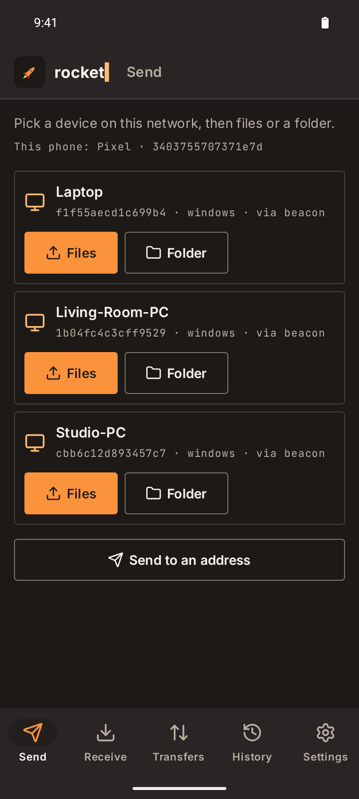
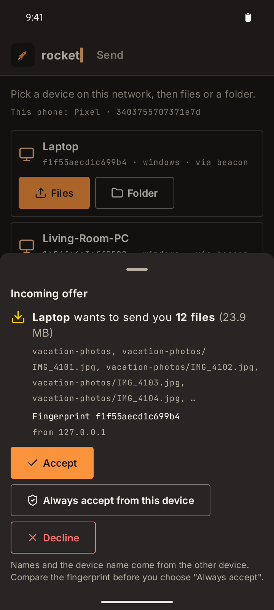
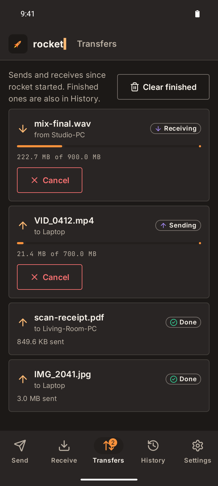
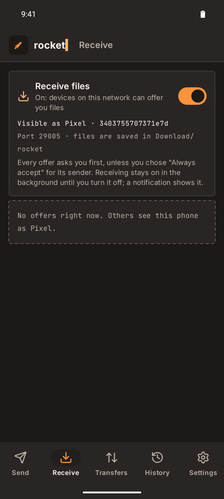

# rocket

**Website: [donaldsteele.github.io/rocket](https://donaldsteele.github.io/rocket/)** ·
[Download](https://github.com/donaldsteele/rocket/releases/latest) ·
[Use it over Tailscale](#over-tailscale)

rocket is a single-binary file transfer tool for a local network. Run it on two
or more computers on the same network and send files and folders between them
directly, with a quick approval on the receiving end. No cloud, no account, no
internet.

It is a companion to [netdiag](https://github.com/donaldsteele/netdiag) and
[bubbles](https://github.com/donaldsteele/bubbles) and shares their shape: one
binary for Windows, macOS and Linux, a local browser UI in a warm theme, and an
MCP server so an AI agent can help. An Android app sends and receives with the
same protocol.

## What it does

- **Peer to peer:** every computer runs rocket. It finds the others on the
  network automatically (UDP beacon and mDNS) and lists them. Pick a peer,
  choose files or a folder, send.
- **Files and folders:** many files or a whole folder go as one transfer with
  one approval, with per-file progress. Either side can cancel.
- **Encrypted transfers:** file contents between rocket apps (desktop and
  Android) are encrypted and authenticated with keys made fresh for every
  transfer. File names, sizes and device names are not encrypted, and the
  browser drop page is not encrypted at all; see [Security](#security).
- **Resume:** when the connection drops during an accepted transfer, the
  receiver keeps what arrived for 24 hours, the sender reconnects by itself
  (up to 5 tries) and only the missing bytes are sent, without a second
  prompt. After the last try the send is **Interrupted**, with **Resume** and
  **Discard**. This works for every send between rocket apps: files picked in
  the desktop page, `rocket send`, MCP and the Android app. Files picked in
  the page stay in the browser, so keep the page open while it reconnects;
  after a reload, Resume asks you to pick the same files or folder again.
- **Android app:** send from the phone (or its share sheet) and receive on it,
  with the same approval prompt and trusted senders. See
  [Android app](#android-app).
- **Drop page:** a phone or guest with no rocket opens the rocket address in a
  browser and uploads straight to that computer.
- **Trust on first use:** the first transfer from a new sender asks the receiver
  to approve it. Tick **Always accept from this host** to remember that
  sender's key. Every offer and every reply is signed, so another computer
  cannot pretend to be a sender you trust.
- **History and settings:** see past transfers, change the device name and
  download folder, and revoke trusted senders.
- **Received files** land in your **Downloads/rocket** folder.
- **Tray icon** (Windows and Linux) shows when someone is waiting for an answer.
- **AI agent access (MCP):** Claude or another agent can list peers and send
  files. It can never accept an incoming transfer, that stays with you.

## Quick start

1. Download the zip for your system from the
   [releases page](https://github.com/donaldsteele/rocket/releases), check it
   against `SHA256SUMS`, and unzip it.

   | system                         | download                   |
   |--------------------------------|----------------------------|
   | Windows PC (most laptops)      | `rocket-windows-amd64.zip` |
   | Windows on ARM                 | `rocket-windows-arm64.zip` |
   | Mac with Apple chip            | `rocket-darwin-arm64.zip`  |
   | Mac with Intel chip            | `rocket-darwin-amd64.zip`  |
   | Linux PC                       | `rocket-linux-amd64.zip`   |
   | Linux on ARM (Raspberry Pi 4/5)| `rocket-linux-arm64.zip`   |
   | Android phone (8.0 or later)   | `rocket-android.apk`       |

   See `HOW-TO-OPEN.txt` for the SmartScreen (Windows) and Gatekeeper (macOS)
   steps for unsigned programs, the firewall prompt, and installing the APK on
   Android.
2. Run `rocket` on each computer. It prints the addresses to open and opens the
   local page in your browser.
3. On the sending computer, the other computers appear under **Computers on
   your network**. Pick one, then **Send files** or **Send folder**.
4. On the receiving computer, **Accept** or **Decline** the offer. Tick
   **Always accept from this host** to skip the prompt next time.

Offers and transfers between rocket apps show a lock and **Encrypted**;
uploads from a browser show **Not encrypted**.

**rocket 1.1 does not talk to rocket 1.0**, in either direction: 1.1 encrypts
transfers with protocol 2. Update every computer and phone. A 1.0 device shows
as **Needs update** in the peer list, and a 1.0 sender is told to update.
Installing 1.1 over 1.0 keeps settings, trusted senders, history and the
phone's fingerprint.

To send from a phone without the app (an iPhone, or a guest's phone), open the
**drop page** address rocket prints (for example `http://192.168.1.20:29005/`)
in the phone's browser and choose files.

## Android app

<p>
<picture><source media="(prefers-color-scheme: light)" srcset="site/assets/shots/android-send-light.png"></picture>
<picture><source media="(prefers-color-scheme: light)" srcset="site/assets/shots/android-offer-light.png"></picture>
<picture><source media="(prefers-color-scheme: light)" srcset="site/assets/shots/android-progress-light.png"></picture>
<picture><source media="(prefers-color-scheme: light)" srcset="site/assets/shots/android-receive-light.png"></picture>
</p>

`rocket-android.apk` runs on Android 8.0 (API 26) and later. It is not in the
Play Store: download the APK from the
[releases page](https://github.com/donaldsteele/rocket/releases) on the phone,
check it against `SHA256SUMS` if you like, and install it (`HOW-TO-OPEN.txt`
has the steps for "install unknown apps" and the Play Protect warning).
Updates install over the old version, because every release is signed with the
same key.

- **Send:** the **Send** tab lists rocket computers and phones on the Wi-Fi
  (UDP beacon and Android's mDNS service discovery). Pick one, then **Files**
  or **Folder**, or use **Send to an address**. From any other app, **Share**
  to rocket and pick a device.
- **Receive:** turn on **Receive files** in the **Receive** tab. The phone is
  then visible under its device name and listens on TCP 29005 (another free
  port if that is taken). Each offer shows a notification with Accept and
  Decline, and a sheet in the app that adds **Always accept from this device**.
  Files go to **Download/rocket**. Receiving runs as a foreground service with
  an ongoing notification and stays on, also in the background, until you turn
  it off.
- **Transfers, History, Settings:** progress with cancel, the last 1000
  transfers, the device name, trusted senders with revoke, and the auto-accept
  switch, as on the desktop. Transfers are encrypted like the desktop's, a
  send that loses its connection shows **Reconnecting 2/5** and carries on,
  and one that gave up is **Interrupted** with **Resume**. The app keeps its
  permission to read the files where the sharing app allows it; otherwise
  Resume asks you to pick them again. A receive cut off by the network is kept
  for 24 hours and continues when the sender tries again.
- **Permissions:** network and Wi-Fi state, Wi-Fi multicast (to hear
  discovery), foreground services (for long transfers and for receiving),
  notifications (Android 13+ asks; without it offers show only in the app),
  and storage on Android 8 and 9 only.
- **Data:** the phone's key, trusted senders and history stay in the app's
  private storage and are left out of backups and device-to-device transfers,
  so a new phone gets a new identity.

The phone serves only the peer protocol (`/api/hello`, `/api/offer`,
`/api/recv`, `/api/recv/cancel`): no drop page, no control API. The
transport is plain HTTP, as on the desktop, with the file contents encrypted
(see [Security](#security)).

## Command line

```
rocket                     start the web UI and announce this host (default)
rocket ui                  same; --no-browser skips opening a window
rocket send <peer|host:port|ip> <path>...
                           send files and folders to a peer by name,
                           fingerprint prefix, or address (a bare IP
                           address means port 29005)
rocket recv                run headless: announce and receive, no browser
rocket pair [5m|stop|status]
                           open a pairing window on the rocket running on
                           this computer: new senders are trusted
rocket trust [list]        the senders whose files arrive without asking
rocket trust add <public-key|fingerprint> [--name NAME]
                           trust a sender ahead of time
rocket trust remove <fingerprint>
                           forget a trusted sender
rocket id                  print this device's name, fingerprint and public
                           key, and the command that trusts it
rocket mcp                 serve the MCP interface for an AI agent over stdio
rocket version             print the version
```

Flags for `ui`, `send`, `recv` and `mcp`:

| flag             | default                  | environment          |
|------------------|--------------------------|----------------------|
| `--port`         | 29005 (TCP)              | `ROCKET_PORT`        |
| `--beacon-port`  | 29006 (UDP)              | `ROCKET_BEACON_PORT` |
| `--data-dir`     | see below                | `ROCKET_DATA_DIR`    |
| `--download-dir` | `Downloads/rocket`       | `ROCKET_DOWNLOAD_DIR`|
| `--name`         | the computer's host name | `ROCKET_NAME`        |
| `--no-mdns`      | mDNS on                  |                      |

`ui` and `recv` also take `--trust <public-key|fingerprint>` (repeatable),
which does `rocket trust add` before starting, and `--pair 5m`, which opens a
pairing window as they start. `trust` and `id` take only
`--data-dir` (and `--name`, which for `trust add` names the sender).

A flag wins over the environment, which wins over Settings, which wins over the
default. Every host on a network must use the same beacon port to see each
other by beacon.

`rocket send` reconnects by itself when the connection drops after the
receiver accepted: it prints `connection lost (...); reconnecting 1/5 in 2s...`
and then `reconnected; continuing where it stopped`. If it gives up after 5
tries, run the same command again within 24 hours and the send continues
where it stopped.

### Trust senders from the command line

Ticking **Always accept** in a prompt needs someone at the receiving screen.
For a headless receiver (`rocket recv` on a Raspberry Pi or a server), or to
set up devices ahead of time, trust senders from the command line instead:

```
# on the sending device: print its key and a ready-made command
rocket id
#   name:        Laptop
#   fingerprint: 9bf1bd9dc2f309f2
#   public key:  7wTVIpUnN18LOcJx3EDrt/kQZt+uNM5mq2Px000xBYY=
#   ...
#     rocket trust add 7wTVIpUnN18LOcJx3EDrt/kQZt+uNM5mq2Px000xBYY= --name Laptop

# on the receiving device: paste it, or trust it as the receiver starts
rocket trust add 7wTVIpUnN18LOcJx3EDrt/kQZt+uNM5mq2Px000xBYY= --name Laptop
rocket recv --trust 7wTVIpUnN18LOcJx3EDrt/kQZt+uNM5mq2Px000xBYY=
```

- **By public key** (what `rocket id` prints): the strongest. Only the device
  holding that key gets in, exactly as if you had ticked Always accept.
- **By fingerprint** (16 hex characters, shown in every rocket screen,
  including the Android app's Receive tab): the first offer whose key matches
  that fingerprint is accepted and its key is pinned from then on. A
  fingerprint is 64 bits of the key's hash, so this is weaker than adding the
  key: use the key when you can.

`rocket trust list` shows who is trusted and whether by key or (until the
first offer) by fingerprint; `rocket trust remove <fingerprint>` makes that
sender's next offer ask again. A rocket already running on the same data
folder picks up changes on its next offer, no restart needed. Trusted
senders skip the prompt only while **Accept files from trusted senders
without asking** is on in Settings (the default); `trust add` warns when it
is off. There is no switch to accept everyone: anyone on the network could
then write files to your disk.

### Pair new devices

When you set up several devices at once, a **pairing window** is quicker than
adding keys: for a few minutes, every rocket device that sends to this one is
accepted without asking and trusted from then on, as if you had ticked
Always accept. Open it with:

- **Desktop page:** **Pair new devices** in the Receive card (5 minutes),
  with a countdown, **Stop**, and the devices paired so far.
- **Tray:** **Pair new devices (5 min)** in the menu.
- **Android:** **Pair new devices** on the Receive tab, while Receive files
  is on.
- **Command line:** `rocket pair` (5 minutes; `rocket pair 10m`, at most an
  hour) on the computer running rocket, `rocket pair stop` to close it early,
  `rocket pair status`; or `rocket recv --pair 5m` to open it as a headless
  receiver starts. The console prints each device it pairs.

Then send something from each of your devices. Anyone else on the network who
sends while the window is open is trusted too, so open it only while you are
pairing, and check `rocket trust list` (or Settings, Trusted senders)
afterwards. Browser drops are never paired, and Claude cannot open a window.

## Where the data is kept

The data folder is `rocket` inside your user configuration folder
(`%AppData%\rocket` on Windows, `~/Library/Application Support/rocket` on
macOS, `~/.config/rocket` on Linux), unless `--data-dir` says otherwise:

- `node.key`: this host's private key. Keep it private.
- `trusted.json`: senders you chose to always accept (fingerprint, name, key).
- `drop_tokens.json`: hashes of remembered drop-page browsers.
- `settings.json`: device name, download folder, auto-accept.
- `history.jsonl`: the last 1000 transfers.
- `resume/`: transfers this computer received in part and keeps for 24
  hours (the part files themselves stay in the download folder).
- `outgoing/`: interrupted sends that can be resumed, with the paths of their
  files (or, for files picked in the desktop page, their names and sizes),
  for 24 hours.

## Tray app

`rocket-tray` is an optional icon for the system tray (Windows notification
area, Linux StatusNotifier tray). Put it next to `rocket` (the zips ship them
together) and run it. Its menu shows:

- whether rocket is running and how many peers it sees,
- how many incoming offers are waiting (the icon gets a red badge; click the
  line to open rocket and answer),
- **Open rocket**, **Start rocket** (runs `rocket ui --no-browser` in the
  background when it is not running), **Quit rocket**, and **Exit tray**
  (closes only the icon; rocket keeps running).

It checks every 2 seconds and talks only to rocket's local API on
`http://127.0.0.1:29005`. Use `--port` (or `ROCKET_PORT`) when rocket runs on
another port, and `rocket-tray --status` to print the status once.

Release zips include the tray for Windows and Linux (amd64 and arm64). On Linux
the desktop needs a StatusNotifier tray (KDE, or GNOME with the AppIndicator
extension). macOS tray binaries are not shipped, because the macOS tray needs
cgo; build it from source on a Mac:

```
cd tray
go build -o rocket-tray .
```

## Connect Claude (MCP)

```
claude mcp add rocket -- "C:\path\to\rocket.exe" mcp      # Windows
claude mcp add rocket -- /path/to/rocket mcp              # macOS / Linux
```

Claude can then use `list_peers`, `send_file`, `get_status` and
`list_history`. `send_file` also takes a private IP address (LAN or VPN such
as Tailscale) for a host discovery does not reach. It cannot accept an incoming transfer, trust or revoke a
sender, change settings, or quit rocket. See [docs/mcp.md](docs/mcp.md).

## Over Tailscale

rocket finds peers with a UDP broadcast beacon and mDNS, which stay on one
network. A VPN such as [Tailscale](https://tailscale.com/) carries neither,
so devices on your tailnet do not show up in the peer list, but rocket works
across it by address:

- **Desktop page:** open **Send to an address** under the peer list, type the
  device's Tailscale address (`100.101.102.103`) or MagicDNS name
  (`home-pc`), and pick files or a folder. Port 29005 if left out. The page
  remembers the last five addresses in that browser.
- **Command line:** `rocket send 100.101.102.103 ./photos` or
  `rocket send home-pc:29005 ./photos` (a host name needs its port, since a
  bare name is looked up as a peer name).
- **Android:** **Send to an address** on the Send tab. Turn on **Receive
  files** to receive over the tailnet as on Wi-Fi.
- **Claude (MCP):** `send_file` takes a private IP address, Tailscale's
  included, when you give it one. It does not take host names or public
  addresses.
- **Drop page:** open `http://home-pc:29005/` in a browser on any device in
  the tailnet.

Tailscale encrypts everything between tailnet devices with WireGuard, so over
a tailnet the names, sizes and device names that rocket leaves visible on a
LAN, and uploads from the browser drop page, are hidden from the networks in
between too. rocket still encrypts file contents inside it. A send to a typed
address is not pinned to a fingerprint, so check the fingerprint in the
receiver's prompt when it matters. If nothing answers, let TCP 29005 in on the
Tailscale network in the receiver's firewall, and check that your tailnet's
access rules allow it.

## Firewall

rocket needs these open on **private** networks:

- TCP **29005**: transfers, the drop page (and the UI, which answers only on
  this computer),
- UDP **29006**: the discovery beacon,
- UDP **5353**: mDNS (optional; `--no-mdns` turns it off).

Windows asks the first time rocket runs: allow it on Private networks. On
Linux with `ufw`:

```
sudo ufw allow 29005/tcp
sudo ufw allow 29006/udp
sudo ufw allow 5353/udp
```

## How it works

- **Identity:** on first run rocket makes an ed25519 keypair in its data
  folder. The short fingerprint of the public key is its stable ID, so trust
  survives an IP or host name change.
- **Discovery:** a UDP broadcast beacon on port 29006 and mDNS
  (`_rocket._tcp.local`) announce each host; both feed one peer list keyed by
  fingerprint, and silent peers expire.
- **Transfer:** a two-phase push on the HTTP port (protocol 2): the sender
  sends a signed offer listing every file with a fresh X25519 key, the receiver
  approves (trust on first use) and answers with a signed reply and its own
  fresh X25519 key, then the sender streams the bytes of every file in order,
  encrypted with ChaCha20-Poly1305 under a key derived for this transfer,
  straight to disk. Nothing is held whole in memory. See
  [docs/protocol.md](docs/protocol.md).
- **Resume:** after a network failure the receiver keeps the authenticated
  part; the sender's next offer for the same files gets the point to continue
  from in the signed reply, checks its own copy of that part, and sends only
  the rest.

## Security

rocket listens on your local network, so any host on your subnet can **offer**
you files; nothing is saved until you accept. The full UI and every control
API answer only on this computer. Offers and replies are signed and trusted
senders are pinned by key (trust on first use: compare the fingerprint before
you choose Always accept).

**What is encrypted:** the contents of every file sent between rocket apps
(desktop and Android, 1.1 and later), with ChaCha20-Poly1305 under a key made
from fresh X25519 keys for each transfer. A change in transit is caught and
the transfer thrown away, and a recorded transfer stays unreadable even if a
device key is stolen later.

**What is not:** the transport is plain HTTP. Anyone who can watch your
network can still see file and folder names, sizes and the folder layout,
device names, fingerprints and versions, and who sends to whom and when. Files
dropped from a browser (the drop page) are not encrypted at all, because
browsers allow web encryption only on HTTPS pages. Sending to a typed
`host:port` encrypts to whoever answers there; pick peers from the list, or
compare fingerprints, when it matters. Use rocket on networks you trust, and
put files in an encrypted archive first if their names must stay private. The
full threat model is in [docs/security.md](docs/security.md).

## Status

Version 1.1. Not included: encryption of file names, sizes and device names
(HTTPS), encryption and resume for the browser drop page, code signing of the desktop binaries, macOS tray binaries, an iPhone
app, a Play Store listing, and transfers over the internet. See
[CHANGELOG.md](CHANGELOG.md).

## Building from source

Go 1.26 or later.

```
go build ./cmd/rocket                         # this platform
VERSION=1.1.0 bash scripts/build.sh           # all release zips into dist/
pwsh scripts/build.ps1 -Version 1.1.0         # same, from PowerShell
go run ./tools/licenses                       # refresh THIRD_PARTY_LICENSES.txt
```

The build script cross-compiles rocket for six targets and the tray for four,
adds the icon and version info to `rocket.exe`, builds the signed Android app
as `dist/rocket-android.apk`, and writes `dist/SHA256SUMS`.

The APK needs an Android SDK with platform 36, build-tools and an NDK
(`ANDROID_HOME`, optionally `ANDROID_NDK_HOME`), JDK 17 or later, `gomobile`
and `gobind` (`go install golang.org/x/mobile/cmd/gomobile
golang.org/x/mobile/cmd/gobind` from this repository, then `gomobile init`),
and the release key. Without the SDK or the key the script prints a warning
and leaves the APK out; `RELEASE=1` (PowerShell: `-Release`) makes that an
error. To build and test only the app (debug), see
[android/README.md](android/README.md):

```
pwsh scripts/build-android.ps1 -AarOnly       # Go core -> android/app/libs/rocketcore.aar
cd android && ./gradlew testDebugUnitTest lintDebug assembleDebug   # Windows: gradlew.bat
```

**Release signing key (maintainers).** `assembleRelease` reads
`keystore.properties` (`storeFile`, `storePassword`, `keyAlias`,
`keyPassword`) from `$ROCKET_KEYSTORE_PROPS`, else from
`~/.rocket-signing/keystore.properties` (`%USERPROFILE%\.rocket-signing` on
Windows). The keystore and its passwords never go into this repository, build
logs or CI; CI builds only the debug APK. **Back up `~/.rocket-signing`**
somewhere safe and offline: Android installs an update only when it is signed
with the same key, so if the key is lost, users have to uninstall the app to
get a new version.

## License

Apache-2.0. See `LICENSE` and `NOTICE`. Third-party licenses are in
`THIRD_PARTY_LICENSES.txt`.
